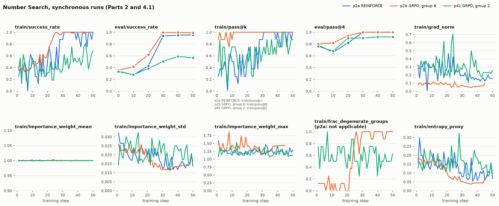
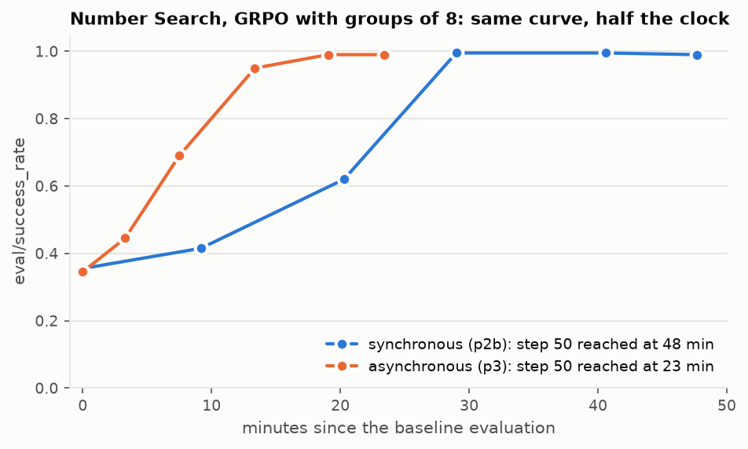
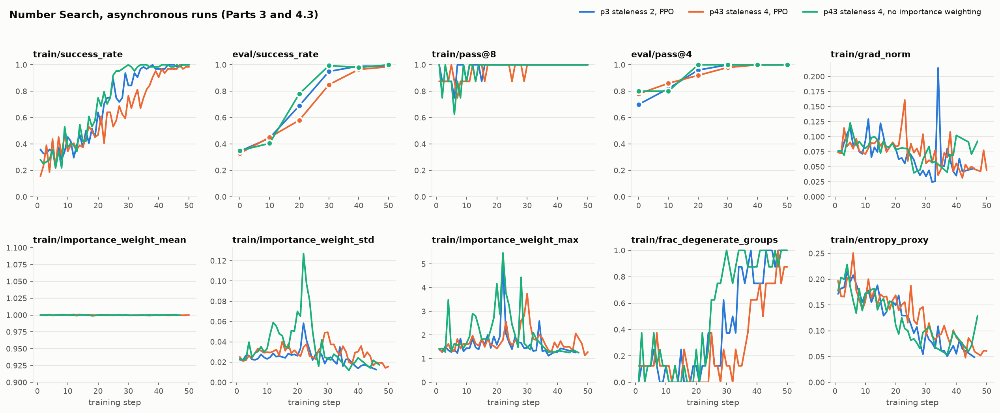
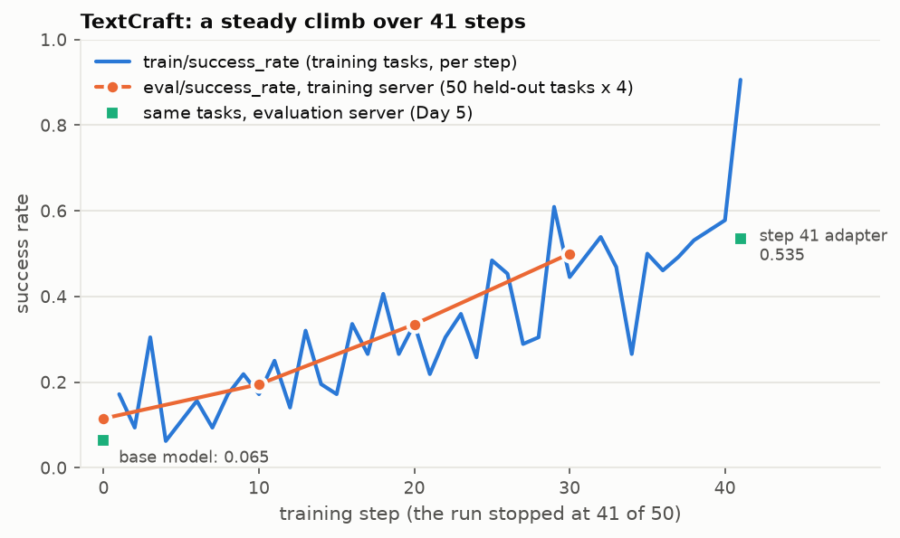
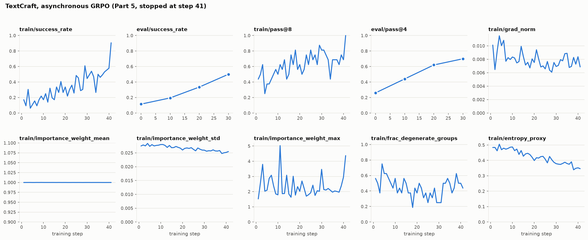
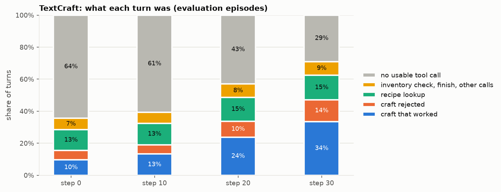
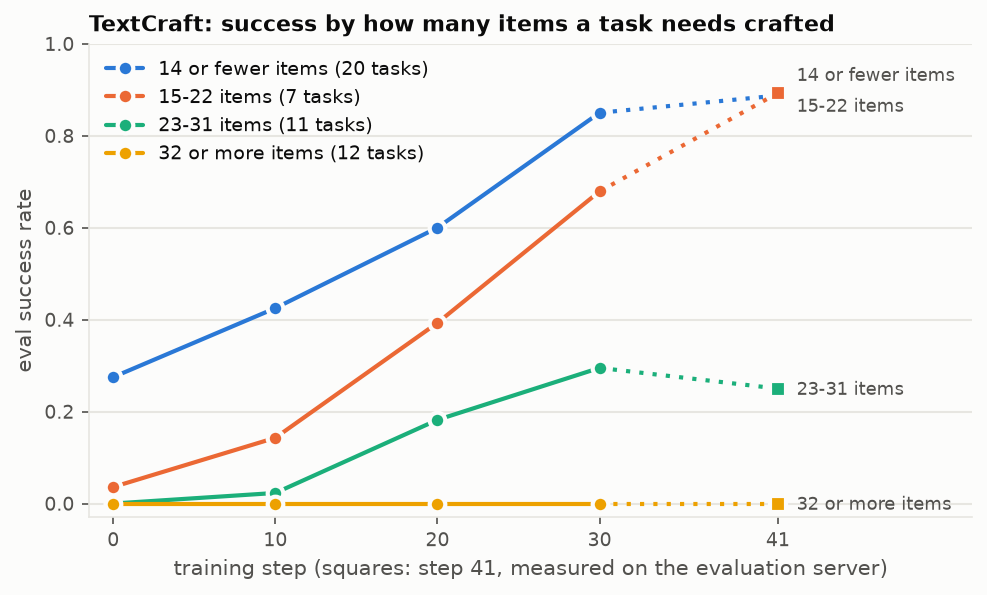
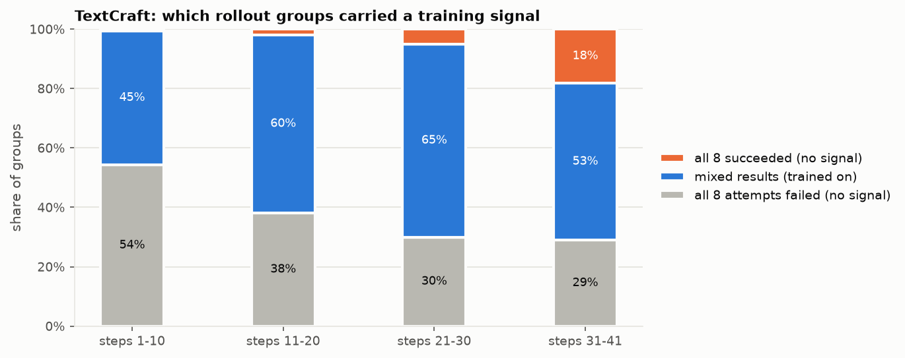

# Assignment 3 report: training a model with reinforcement learning on rented GPUs

CMU 11-768 Assignment 3 (ScottyRL), done independently in one week, Nov 8-14, 2026. This is
a learning run, not a course submission. It covers two things side by side: what the
reinforcement learning showed, and what it was like to rent H100s on Modal to do it.

- Day-by-day detail: [Learning-Progress.md](Learning-Progress.md) (the RL) and
  [cloud-walker-Modal.md](cloud-walker-Modal.md) (the infrastructure).
- Every number here comes from files in `runs/`. The figures are drawn by
  `scripts/make_report_plots.py`.

## Summary

| | Result |
|---|---|
| Model | `Qwen/Qwen3.5-4B` with a rank-32 LoRA adapter, trained through SkyRL's Tinker server |
| Number Search (6 runs, 50 steps each) | Held-out success from about 0.35 to 0.99 in four of the six runs |
| Asynchronous training | The same learning curve as synchronous in half the wall-clock time |
| TextCraft (1 run, stopped at step 41 of 50) | Held-out success from 0.12 to 0.50 at step 30; the step-41 adapter scored 0.535 on a separate server |
| What TextCraft training changed | The share of turns with no usable tool call fell from 64% to 29% |
| What stopped it | The 75-turn limit: the model needs about 2.8 turns per crafted item and never solved a task with more than 31 |
| Cost | About $262 on Modal, against a budget of $250; $197 of it was the TextCraft run |
| Lost to infrastructure | About $12 on an evaluation that stalled, and 9 steps of the TextCraft run |

Three things we would tell someone starting this:

1. **Use the cheap task to prove the trainer, then spend once.** Six Number Search runs cost
   about $44 together, probes and image build included, and caught every wiring problem. The TextCraft run cost four times
   that and could not be repeated.
2. **A long timeout turns a rare failure into the main cost.** Both infrastructure failures
   this week were lost requests that a client waited on for minutes or hours.
3. **The reward decides what can be learned.** TextCraft pays only for a finished task, so a
   third of the tasks never produced a training signal, although the model got further into
   them as training went on.

## What was built and what differs from the course

The course provides the environments, the agent, the Modal launch scripts and the test
suite. We wrote the six files it leaves open (advantages, trajectory stitching, the shared
batch code, one Tinker call, the synchronous trainer and the asynchronous trainer),
test-first, and ran everything on our own Modal account.

| Course setup | Ours |
|---|---|
| Hidden grading suite and a packaged submission | The public tests plus our own offline end-to-end test (75 tests at the end) |
| Trainer for Part 5 run from your own machine | Run in a CPU container on Modal, so the overnight run did not need the Codespace |
| Part 5: all 50 steps | Stopped at step 41 after the GPU server began leaving requests stuck |
| Part 5 evaluation: full validation set and a hard set, about 2,800 episodes | The first 50 validation tasks, 4 attempts each, for both models (400 episodes); no hard set |
| Adapter published to Hugging Face | Evaluated from the copy downloaded from the Modal volume |
| Weights & Biases charts | Plots drawn from the logs in `runs/` |

Model, LoRA rank, environments, algorithms and configs are unchanged, so the numbers are
comparable with the course's, with the limits listed at the end.

## Part 1: from an episode to a training batch

An episode is several model calls. Each call's prompt is the previous prompt plus the
previous completion plus the environment's reply, so the whole episode can be laid out as
one token sequence and trained in one pass. A mask marks the tokens the policy sampled; only
those enter the loss. The episode's advantage, its reward measured against a baseline, is
copied onto every masked token.

- **REINFORCE** uses no baseline: advantage = reward.
- **GRPO** runs a group of attempts at one task and subtracts the group's mean reward. A
  group whose attempts all got the same reward teaches nothing and is skipped.

The check that this was right on real data: in every synchronous run the importance weight
(the current policy's probability of a sampled token over the sampling policy's) averaged
1.000. A misaligned mask or log-probability would have moved it far from 1.

## Part 2: REINFORCE and GRPO on Number Search

Guess a hidden integer with too-high and too-low feedback inside a step budget. Held-out
evaluation: 50 tasks, 4 attempts each.

| Run | Algorithm | Episodes per step | Step 0 | Step 20 | Step 30 | Step 50 |
|---|---|---|---|---|---|---|
| `p2a` | REINFORCE | 8 | 0.340 | 0.430 | 0.935 | 0.955 |
| `p2b` | GRPO, group of 8 | 64 | 0.355 | 0.620 | 0.995 | 0.990 |
| `p41` | GRPO, group of 2 | 16 | 0.330 | 0.385 | 0.505 | 0.565 |

- **The model learned the task, and it learned it as a jump.** Both `p2a` and `p2b` were near
  the baseline at step 10 and essentially solved by step 30.
- **GRPO with 8 attempts was the cleanest**, and its gradient norm was the smallest: 64
  episodes average out more noise than 8.
- **REINFORCE did better than expected.** With 0-or-1 rewards it reinforces what the
  successful episodes did and ignores the rest, which is enough on a task this simple. Its
  curve was rougher (a dip to 0.275 at step 10).
- **The step-0 figures differ by 0.025 between runs of the same untrained model.** That is
  the noise floor for everything else here. Each configuration ran once, so small
  differences between runs are not evidence.

## Part 3: asynchronous training

The synchronous loop makes sampling wait during updates and the learner wait during
rollouts. The asynchronous trainer overlaps them: rollout workers feed a bounded queue, the
learner trains on what is there, and data sampled too many policy versions ago is dropped.

| | `p2b` synchronous | `p3` asynchronous |
|---|---|---|
| Success at step 50 | 0.990 | 0.990 |
| Wall-clock time for 50 steps | 49.0 min | 24.6 min |
| Learner waiting for data | 32.4 min | 5.1 min |
| Time in updates | 11.6 min | 13.3 min |
| Groups dropped as stale | not applicable | 53 of 453 (12%) |

- **Same curve, half the clock.** Step for step the two runs match within noise. The
  synchronous learner spent two thirds of its run waiting; the asynchronous one a fifth.
- **The price is slightly off-policy data.** The importance weight still averaged 1.000, but
  its spread was wider than in the synchronous run (0.025 against 0.019), and 12% of the
  sampled groups were thrown away as too old.

## Part 4: group size, staleness and importance weighting

**Group size (4.1).** With a success rate p and a group of 2, both attempts agree with
probability p² + (1 - p)². At p = 0.35 that is 0.55, so more than half of the groups carry
no signal before training starts. The log agrees: `p41` discarded 53-64% of its groups
throughout and was still climbing at step 50 (0.565). A group of 8 is almost never all-same
early on. The opposite happens late: once `p2b` succeeded 99% of the time, 97.5% of its
groups were all-success and 18 of its 50 steps were skipped.

**Staleness and importance weighting (4.3).** Two more asynchronous runs accepted data up to
4 versions old, one with the PPO loss (importance-weighted and clipped) and one with plain
advantage-weighted cross-entropy.

| | `p3` (staleness 2, PPO) | `iw` (staleness 4, PPO) | `noiw` (staleness 4, no weighting) |
|---|---|---|---|
| Success at step 50 | 0.990 | 0.985 | 1.000 |
| Groups dropped as stale | 53 | 0 | 1 |
| Learner waiting for data | 5.1 min | 1.2 min | 7.1 min |
| Importance-weight spread, highest step | 0.058 | 0.049 | 0.127 |
| Smallest single-token ratio | 0.121 | 0.315 | 0.013 |

- **All three ended in the same place.** Raising the staleness limit cost nothing in final
  quality on this task, with or without the correction.
- **The uncorrected run drifted further from its sampler.** Its importance weights are
  computed but not used, so they show how off-policy its data was: the spread peaked at
  0.127, and single tokens went as low as a ratio of 0.013. It trained on those at full
  weight.
- **It did not matter here** because the badly off-policy tokens were a small tail, on an
  easy task, with a small learning rate. That is a statement about Number Search, not about
  importance weighting.

## Part 5: TextCraft

Craft a target item from an inventory by following a recipe tree, with four tools
(`get_info`, `craft`, `view_inventory`, `finish`), thinking enabled, 512 tokens per turn and
75 turns per task. Asynchronous GRPO, 16 groups of 8 attempts per step.

### The run

| Step | Server | Success | pass@4 | Average turns |
|---|---|---|---|---|
| 0 (base model) | training | 0.115 | 0.26 | 64.5 |
| 0 (base model) | evaluation | 0.065 | 0.14 | 67.4 |
| 10 | training | 0.195 | 0.44 | 60.5 |
| 20 | training | 0.335 | 0.62 | 56.4 |
| 30 | training | 0.500 | 0.70 | 53.0 |
| 41 (the adapter) | evaluation | 0.535 | 0.68 | 54.0 |

- **It learned steadily, without a jump**, and the run stopped at step 41 of 50 when the GPU
  server began leaving requests stuck (see the cloud section).
- **The adapter works outside the server that trained it.** Served by plain vLLM on two
  H100s, it scored 0.535, next to step 30's 0.500.
- **The uncertainty on these rates is about 0.06** (computed across tasks, because attempts
  at one task tend to succeed or fail together). So 0.500 and 0.535 cannot be told apart,
  and the two base-model figures are compatible with each other.
- **By task, the change is large.** The step-41 model beat the base model on 33 of 50 tasks,
  tied on 16 and lost on 1. It solved 17 tasks in all four attempts; the base model, 1.

The importance weight stayed at 1.000 on average through the run, and entropy fell slowly.
Nothing in the optimization looked unhealthy; what the run lacked was time.

### What the model learned

From 2,004 saved transcripts (`scripts/analyze_p5.py`, results in `runs/p5_analysis.json`).

- **The base model wastes almost two turns in three.** 64% of its turns produce nothing the
  environment can act on. That, more than wrong recipes, is why it runs out of turns.
- **Training turned wasted turns into crafts.** By step 30 the wasted share was 29% and
  successful crafts had gone from 10% of turns to 34%. Lookups stayed where they were.
- **One turn in ten is still cut off at the 512-token limit**, and training did not reduce
  that (8% at step 0, 11% at step 30). It is now more than a third of the remaining waste.
- **Crafting got only a little more accurate**: 62% of craft calls worked at step 0, 71% at
  step 30. The main error throughout is a wrong amount of an ingredient.
- **Thinking longer does not go with success.** Over the first ten turns, solved and
  unsolved episodes use the same number of tokens per turn. Between attempts at the same
  task, the solved one used fewer about 55% of the time.

One thing the counts cannot say: a third of the base model's turns end with the thinking
finished but no parseable tool call after it (16% at step 30). Whether those are calls in
another format or no call at all needs a reading of the transcripts, which we have not done.

### What stopped it

Each task records how many different items must be crafted to reach its target. Each needs
at least one `craft` call.

| Items to craft | Tasks | Step 0 | Step 10 | Step 20 | Step 30 | Step 41 |
|---|---|---|---|---|---|---|
| 14 or fewer | 20 | 0.28 | 0.43 | 0.60 | 0.85 | 0.89 |
| 15-22 | 7 | 0.04 | 0.14 | 0.39 | 0.68 | 0.89 |
| 23-31 | 11 | 0.00 | 0.02 | 0.18 | 0.30 | 0.25 |
| 32 or more | 12 | 0.00 | 0.00 | 0.00 | 0.00 | 0.00 |

- **The steady climb is several delayed jumps.** Each size class takes off later than the one
  below it. Number Search has one class and one jump.
- **The turn limit is the ceiling.** A solved task costs the model 2.7-3.0 turns per item,
  the same at step 0 and at step 30. At that rate 75 turns cover about 26 items. Nothing
  above 31 was ever solved.
- **Those tasks are possible.** One lookup can cover many items and one craft call can make
  any multiple, so a task with n items fits in about n + 2 turns; the largest validation
  task, 55 items, fits in 75. The model became reliable at acting, not economical.
- **It got further on the tasks it could not finish**: failed attempts at the largest tasks
  completed 14% of the recipe tree at step 0 and 42% at step 30. The reward pays nothing for
  that.

GRPO only learns from groups whose attempts disagree. Early, more than half the groups were
all-fail. By the end the all-fail share had settled near 30%, which matches the 36% of
training tasks that need more than 22 items, and another 18% were tasks the model always
solved. Over the run, 44% of the generated episodes were never trained on.

## The cloud side: renting H100s on Modal

### How it was set up

One Modal container per run holds everything that needs a GPU: vLLM engines for sampling and
Megatron for training, behind SkyRL's Tinker-compatible server. The trainer is a plain Python
process with no GPU and no PyTorch that talks to it over HTTPS. Weights live on a shared
volume, checkpoints and adapter snapshots on a volume per app. Containers scale to zero five
minutes after their last request.

| Runs | GPUs | Layout |
|---|---|---|
| Synchronous Number Search | 2 H100s | Both GPUs sample, then both train |
| Asynchronous Number Search | 2 H100s | One samples, one trains |
| TextCraft | 4 H100s | Three sample, one trains |
| TextCraft evaluation | 2 H100s | vLLM only, base model and adapter from one endpoint |

### What it cost

| Stage | What ran | Cost |
|---|---|---|
| Days 1-3 | Image build, probes, six Number Search runs (up to 6 H100s at once) | about $44 |
| Day 4 | TextCraft: 4 H100s for about 11 hours ($186.58), plus the trainer container ($10.90) | $197 |
| Day 5, first attempt | Evaluation from the Codespace: stalled, no scores | about $12 |
| Day 5, second attempt | Evaluation from inside Modal: 23 and 17 minutes | about $8-9 |
| **Total** | | **about $262** |

The Day 4 figures are from Modal's per-app breakdown. The Day 5 figures and the total are
our estimates from run times; the dashboard has the exact number.

Cost per point of held-out success gained: about $5 for TextCraft. For a Number Search run
it is about 5 cents counting the run's own GPU time, or 12-15 cents with cold starts and
probes. The TextCraft run trained on about 80 times as many tokens as a Number Search run,
and its learner spent 73% of its time waiting for episodes.

### What went wrong, and what each one taught

| When | What happened | Cost | Cause | What we changed |
|---|---|---|---|---|
| Day 1 | The pinned Modal client refused the new workspace's image builder | Minutes | A pinned course repo drifting behind the service | Upgraded that one package in the lockfile |
| Day 3 | A $20 monthly spend limit on a new account | A day of waiting | An account limit nobody mentions at sign-up | Asked Modal; limit raised to $1,000, set to $300 |
| Day 3 | Stopped two apps while a run was in its cold start | One extra cold start per server | `modal app stop` gives a running client no warning | Stop only after the run prints its last line |
| Day 4 | Requests stuck on the GPU server; one crash, one hang; run stopped at step 41 | 9 steps, about 2 hours of 4 H100s | Unknown on the server side. The client waited 7,200 seconds per stuck request | A watchdog that treats an hour of silence as a hang |
| Day 5 | Evaluation at 1.25 requests per second instead of about 8; stopped after 75 minutes with nothing saved | About $12 | About 4% of requests lost between the Codespace and Modal (inferred), each waited on for 600 seconds | 10 s and 120 s timeouts with retries, results saved per episode, a speed check, and the evaluation moved into Modal |

The last two are the same failure with different numbers. In both, a small fraction of
requests went missing and a client sat on each one for far longer than a request takes. With
the fix in place, the second evaluation sent 24,440 requests from inside Modal and lost
none, which points at the Codespace's connection as where the first attempt's requests
went. One clean night is not proof.

### Modal next to AWS

The earlier Mario_Ops project trained a small network on an EC2 instance we managed
ourselves. The AWS column below is read from that repository where it applies; the rows on
limits and on debugging are general AWS behavior.

| Concern | AWS in Mario_Ops | Modal here |
|---|---|---|
| What you rent | An instance, chosen by type | A function with `gpu="H100:2"` declared in code |
| Preparing the host | Machine image, drivers, container toolkit, disk | Nothing; there is no host |
| Where the training loop runs | On the instance, next to the GPU | Anywhere; the GPUs are a service behind a URL |
| Storage | S3 through an SDK | Volumes mounted as directories |
| Billing | Per instance until you stop it | Per second while a container is up, plus five idle minutes |
| First limit you meet | A quota that blocks the launch | A spend limit that stops work in progress |
| Interruption | Two minutes' warning on a spot reclaim | None; resume from the last checkpoint |
| Seeing inside a failure | Log in and look | The request log, and nothing else |

- **What Modal made easy.** Three experiments side by side were one file deployed three
  times. Leaving a job running overnight was one `spawn()` call. Nothing billed while idle,
  and nothing needed tearing down.
- **What it made hard.** When the server's requests got stuck there was no machine to log in
  to. And every request crosses Modal's public front end, even between two of our own
  containers, so the client has to be written for an unreliable network.
- **What carried over from AWS.** Find the quota page before planning the big job;
  checkpoint often enough that a kill costs minutes; and put the client next to the server.

## RL and infrastructure, side by side

The two halves of the week kept showing the same things.

| | In the RL | In the infrastructure |
|---|---|---|
| Most of the cost is waiting | The TextCraft learner waited for episodes 73% of the time | Clients waited minutes to hours on requests that were already lost |
| Waste hides in an average | 44% of TextCraft episodes carried no signal; the success curve does not show it | The server's request log said 2 seconds; the client was getting one request in 26 seconds through |
| A probe is not the real run | The 2-step TextCraft probe was update-bound and predicted 6-8 hours; the run was generation-bound and needed 10.5 | A 2-episode test passed; 32 at once from the Codespace stalled |
| Check the cheap signal first | Importance weight at 1.000 confirmed the data pipeline before any learning showed | Requests per second in the first two minutes would have saved the first evaluation |
| Budgets shape behavior | 75 turns per task decided which tasks could be learned | A 600-second timeout decided how much a lost request cost |

## What a next run would change

Not planned. In order of how directly the evidence supports each:

1. **The per-turn token limit.** One turn in ten is cut off mid-thought at 512 tokens, and
   training did not reduce it.
2. **Reward for progress.** A third of the tasks give no signal because finishing is out of
   reach, while the model completes up to 42% of them.
3. **Task sampling.** By the end 18% of groups were tasks the model always solved.
4. **A fresh server for long runs.** The stuck requests appeared after hours on one
   container; the retries reused it.

## Limits of this report

- **One run per configuration.** Differences of a few points between runs are within noise;
  the step-0 evaluations of one untrained model already differ by 0.025 on Number Search.
- **TextCraft stopped at step 41**, and its step-40 evaluation was lost in the crash.
- **The evaluation is reduced:** 50 validation tasks, no hard set. The uncertainty on a
  success rate is about 0.06.
- **Step 41 and one base-model figure were measured on a different server** from steps 0-30.
  The adapter's agreement with step 30 suggests the servers agree; the base model's two
  figures differ by 0.05, which one evaluation cannot settle.
- **The transcripts cover every fifth training step**, and in an asynchronous run a step's
  transcripts mix a few neighboring policy versions.
- **The lost-request rate on Day 5 is inferred** from throughput, not measured.
- **Total spend is an estimate** to within a few dollars.
